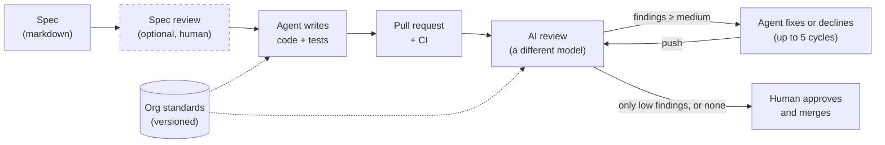
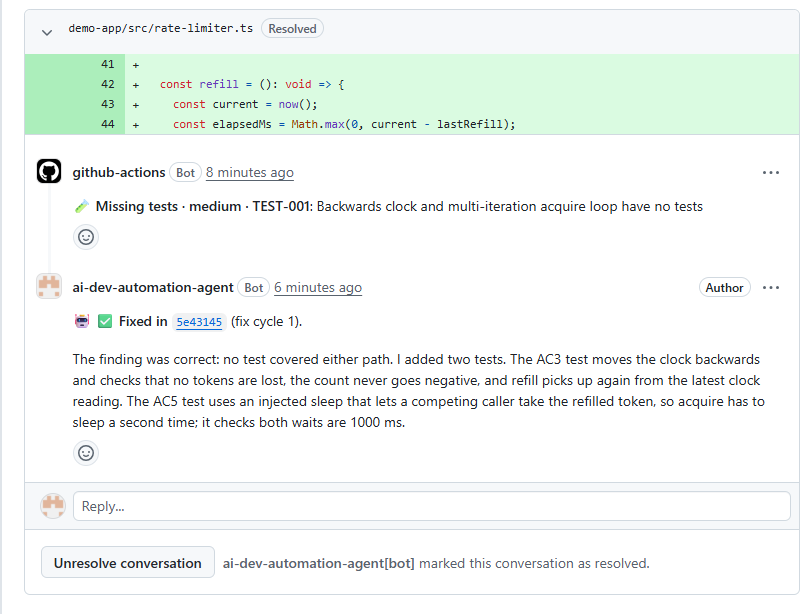
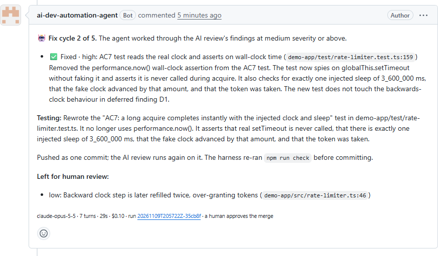

# ai-dev-automation

**spec → agent writes the code → PR → AI review → agent fixes → human approves**



AI coding agents are fast, but unattended they are hard to trust. This repo shows one way to make them trustworthy: the agent works from a written spec, guardrails enforced in code and checked in CI limit what it can do, a second model reviews every change, and a person still approves every merge.

## See it run: [PR #23](https://github.com/gonzzza/ai-dev-automation/pull/23)

The agent implemented [`specs/001-rate-limiter.md`](specs/001-rate-limiter.md) from the *Implement a spec* workflow, as its own GitHub App, with the [org standards](#org-standards) the review also checks. The loop took it from there with no human involved:

1. **The agent opened the PR** as `ai-dev-automation-agent[bot]`: a token bucket rate limiter with a test for every acceptance criterion, each named after its criterion ID, in 14 turns, for $0.29.
2. **The AI review found a gap** (medium, citing standard `TEST-001`): no test for a clock that steps backwards or for `acquire` sleeping twice.
3. **Fix cycle 1 added both tests**, for $0.16, then replied on the finding's thread and resolved it:

   [](https://github.com/gonzzza/ai-dev-automation/pull/23#discussion_r4517880957)

4. **The next review caught the agent's own test reading the real clock** (high, breaking `TEST-002`, the standard on injected clocks). **Fix cycle 2 rewrote it**, for $0.10, and left one low finding for the human:

   [](https://github.com/gonzzza/ai-dev-automation/pull/23#issuecomment-6751295016)

5. **The last review had only a low finding**, so the loop stopped and handed the PR to a human, who decides whether it merges.

Every commit, comment and reply on the PR comes from the bot, about $0.55 of agent spend in all. One of the low findings is a clock bug: a clock that steps backwards later gets refilled twice. As in the first run below, the reviewer rated a clock bug low, so the agent left it alone and a person decides.

### The second run: [PR #17](https://github.com/gonzzza/ai-dev-automation/pull/17)

The same spec, run before the agent had its own identity. It opened the PR under the maintainer's account, so the PR looked hand-written, and its fix cycle fixed a finding but never replied on the thread. Two bugs, both fixed since: the reply step matched no comments ([#20](https://github.com/gonzzza/ai-dev-automation/pull/20)), and the agent acted as a person ([#22](https://github.com/gonzzza/ai-dev-automation/pull/22)). Closed, superseded by #23.

### The first run: [PR #5](https://github.com/gonzzza/ai-dev-automation/pull/5)

The same spec, before the agent had standards or the spec had criterion IDs. It's closed now and kept as the record of how the loop got here:

1. **The agent opened the PR:** a token bucket rate limiter with 22 tests, in 13 turns, for $0.74.
2. **The AI review found a bug the agent's tests missed.** Refill stopped after the system clock stepped backwards.
3. **Fix cycle 1 made it worse.** That run of the reviewer rated the clock bug *low*, so the agent wasn't asked to fix it. While adding the tests it was asked for, the agent wrote one that treated the bug as intended behavior. The loop's stop rule also misfired.
4. **The design was fixed ([#8](https://github.com/gonzzza/ai-dev-automation/pull/8)).** The fixer now sees low findings as context it must not lock in, and the loop stops only when a finding comes back, not on a count.
5. **Fix cycle 2 fixed the bug** and rewrote the wrong test, for $0.13.
6. **The final review had one low finding left**, so the loop stopped and handed the PR to a human.

That history is the point of the demo. The automation caught a real bug, made a mistake, and stayed bounded. Every step is visible on the PR for the person who decides.

## Review the spec, before any code

The spec is the cheapest place to catch a mistake. The agent builds what the spec says, so if the spec leaves a behavior undefined, no later step can reliably get it right.

The clock bug in the runs above is that kind of gap. [Spec 001](specs/001-rate-limiter.md) makes the clock injectable but never says what the limiter does when the clock steps backwards. With no defined right answer, the reviewer rated the bug medium, then low, then medium, and one fix cycle locked it in as a test. One line in the spec would have settled it before the agent ran.

A spec reaches `main` through a pull request, like code, and in CI the agent implements only specs on `main` ([`implement-spec.yml`](.github/workflows/implement-spec.yml)). That PR is where a product owner or tech lead reviews the requirements, the edge cases and the acceptance criteria. How much review it gets is up to the team: a small, well-understood change can merge after a quick look, while a payment flow should get its owner's review. [`specs/README.md`](specs/README.md#review-the-spec) lists what to look for. `/write-spec` already pushes back on criteria it can't test, but it can't know what the business needs.

## What's in the repo

| Path | What it is |
|------|------------|
| [`spec-coding-agent/`](spec-coding-agent) | The spec-driven agent, built on the [Claude Agent SDK](https://code.claude.com/docs/en/agent-sdk). It reads a spec, implements it with tests, verifies the result independently, and opens a PR. In fix mode it addresses review findings on its own PRs. |
| [`review-action/`](review-action) | A GitHub Action that reviews a PR's diff with Claude and posts inline comments on bugs, security issues and missing tests. Other repositories can use it on its own. |
| [`.github/workflows/`](.github/workflows) | CI (`npm run check`) and the AI review with the fix cycle on this repo's own PRs; *Implement a spec*, which runs the agent as its GitHub App; and *Release review action*. |
| [`specs/`](specs) | Feature specs, the agent's input. [`specs/README.md`](specs/README.md) has the template. |
| [`.claude/skills/write-spec/`](.claude/skills/write-spec/SKILL.md) | A Claude Code skill, `/write-spec <idea>`, that turns a rough idea into a spec: grounded in the code, with the open questions settled and every acceptance criterion testable. |
| [`.claude/skills/code-spec/`](.claude/skills/code-spec/SKILL.md) | A Claude Code skill, `/code-spec <spec>`, that implements a spec and opens a PR. It asks who codes it: the agent, in CI as its GitHub App or locally (API spend, guardrails enforced in code), or the Claude Code session itself (no API spend, the agent's brief and checks followed by hand). |
| [`.claude/skills/fix-review/`](.claude/skills/fix-review/SKILL.md) | A Claude Code skill, `/fix-review <PR>`, that runs the fix cycle from the session on a PR the agent's App didn't open: it fixes or declines each AI review finding, runs the agent's gates, and after the user's yes pushes, replies on each thread and waits for the next review. Same limits as the CI fix cycle. |
| [`demo-app/`](demo-app) | A small TypeScript library the agent works on. |
| [`org-standards/`](org-standards) | Sample org engineering standards. **A stand-in for a separate platform repo**, kept here so the demo is self-contained. See [Org standards](#org-standards). |
| [`standards/`](standards) | The parser and selector for those standards, shared by the agent and the review action. |

## Setup

### Add the AI review to your repository

The review action works on its own. Add an `ANTHROPIC_API_KEY` repository secret, then this workflow:

```yaml
# .github/workflows/ai-review.yml
name: AI review
on:
  pull_request:
    types: [opened, synchronize, reopened, ready_for_review]
permissions:
  contents: read
  pull-requests: write
jobs:
  review:
    if: ${{ !github.event.pull_request.draft }}
    runs-on: ubuntu-latest
    steps:
      - uses: gonzzza/ai-dev-automation/review-action@v1
        with:
          anthropic-api-key: ${{ secrets.ANTHROPIC_API_KEY }}
```

The inputs (model, effort, `fail-on`, exclusions) are in [`review-action/README.md`](review-action/README.md).

### Run the whole loop

You need Node 24 or later, `git`, an authenticated [`gh`](https://cli.github.com/), and an Anthropic API key. Start with a fork, so the agent opens PRs on your copy.

```sh
git clone https://github.com/<you>/ai-dev-automation && cd ai-dev-automation
npm ci
npm run check                      # lint, typecheck, tests in every workspace, and spec validation

export ANTHROPIC_API_KEY=sk-ant-...
npm run agent -- specs/001-rate-limiter.md --dry-run   # implement and verify, no commit
npm run agent -- specs/001-rate-limiter.md             # open the PR
```

The agent creates the branch `agent/001-rate-limiter`, so delete that branch first if it already exists. In Claude Code, `/code-spec 001` checks these preconditions and runs the agent for you. To write your own spec, run `/write-spec <your idea>` in Claude Code, or copy the template in [`specs/README.md`](specs/README.md).

### Run the loop in CI, as a bot

In CI the agent acts as its own [GitHub App](https://docs.github.com/en/apps/creating-github-apps/about-creating-github-apps/about-creating-github-apps), so its PRs, commits, comments and thread replies show as `<app>[bot]`, not as a person. That also lets you approve its PRs: GitHub doesn't let anyone approve their own.

1. [Create a GitHub App](https://github.com/settings/apps/new) with webhooks off and these repository permissions: *Contents* read and write, *Pull requests* read and write. Leave *Workflows* at no access, so GitHub rejects any agent push that changes `.github/workflows/`.
2. Install it on this repository only, and generate a private key.
3. Add these to the repository:

| Name | Kind | Used for |
|------|------|----------|
| `ANTHROPIC_API_KEY` | Secret | The review and the agent |
| `AGENT_APP_CLIENT_ID` | Variable | The App's client ID, from its settings page |
| `AGENT_APP_PRIVATE_KEY` | Secret | The App's private key (`.pem` contents) |

Then run **Implement a spec** from the Actions tab with a spec path. The App opens the PR, the AI review runs, and the fix cycle answers its findings. Each job mints a one-hour token scoped to this repository, so no personal token is involved.

Without the App, the review still runs, and only the fix cycle and *Implement a spec* fail. On a fork, also enable GitHub Actions under the fork's **Actions** tab, since forks start with workflows disabled.

## Org standards

Every repo's agent and review follow the same engineering standards, kept in one place and owned by the platform team. A standard is a short markdown file with an id, a severity and the files it applies to ([format](org-standards/README.md)):

- **The agent** gets them in its system prompt, so the code it writes follows them from the start. Spec and fix runs both get them.
- **The review** checks each PR against the standards that apply to its changed files. A finding that breaks one cites it, e.g. `🐛 Bug · medium · TS-002`.
- **Every run records which standards it used, at which version:** the review summary, the agent's PR body and its audit log.

**In this repo**, the standards live in [`org-standards/`](org-standards) so the demo is self-contained. The review job and the fix job both read them from the PR's base commit, so a PR can't change the rules it's reviewed and fixed against. That commit's SHA is the version each run records. It isn't a pin, though: the base follows `main`, so a standards change merged there applies to the next PR straight away, with no bump PR. Locally, `--standards org-standards` reads your working tree.

**In an enterprise setup**, they belong in their own repository, for example `acme/engineering-standards`:

- The platform team owns it through CODEOWNERS, and changes to a standard are reviewed like code.
- Each repo pins a tag (`v3.2.0`, never a branch), so reviews are reproducible. New standards arrive through a version-bump PR, for example from Renovate, that the team can review.
- Each repo picks the packs that fit its stack (`typescript`, `testing`, `api`, …).

The workflow checks out the pinned standards next to the code and passes the path to the action:

```yaml
steps:
  - uses: actions/create-github-app-token@v3   # read access to the standards repo
    id: app
    with:
      client-id: ${{ vars.STANDARDS_APP_CLIENT_ID }}
      private-key: ${{ secrets.STANDARDS_APP_KEY }}
      owner: acme
      repositories: engineering-standards
  - uses: actions/checkout@v7
    with:
      repository: acme/engineering-standards
      ref: v3.2.0
      path: .standards
      token: ${{ steps.app.outputs.token }}
      persist-credentials: false
  - uses: gonzzza/ai-dev-automation/review-action@v1
    with:
      anthropic-api-key: ${{ secrets.ANTHROPIC_API_KEY }}
      standards-path: .standards
      standards-packs: typescript,testing
      standards-ref: v3.2.0
```

The agent takes the same checkout: `--standards .standards --standards-ref v3.2.0`. Standards are trusted input, so they go in the system prompt, and they must come from a pinned ref or the base branch, never from the PR being reviewed.

## How it stays safe

The agent runs unattended on input that might not be trustworthy, so its limits are enforced in code and unit tested. Its prompt alone doesn't enforce them.

- **No shell.** The agent can read, write and search files, and it has one tool that runs `npm run check`. A permission hook decides every tool call. Writes are allowed only inside the target directory, never in the files that define how the checks run or the repo's workflows, and never in files that may hold credentials.
- **Independent verification.** After the agent finishes, the harness re-runs the checks. It confirms that git's branch, commit, config and hooks are unchanged, that every changed file is in scope, and that nothing in the diff, PR body or comments looks like a credential. If any check fails, nothing is committed. CI then runs the checks again on a clean checkout.
- **Bounded.** Each run has turn and budget limits. The fix cycle stops after 5 fix commits, or as soon as a finding comes back. It only touches PRs that the agent's App opened, and it never merges.
- **Auditable.** Every run has an id that appears in its commits (`Agent-Run` trailer), PR body and comments. It writes a redacted JSONL audit log with the full transcript, every permission decision and a categorized outcome, and CI keeps that log as an artifact. In CI, agent-written tests run in a sandbox that can't reach the log. Metrics come from that log, and the agent can also send OpenTelemetry data to an existing monitoring stack. See [Audit log and monitoring](spec-coding-agent/README.md#audit-log-and-monitoring).
- **Model-written code never runs where the secrets are.** In CI, the tests the agent writes run in a throwaway Docker container with no network, no secrets, no view of the audit log and a read-only `.git`. See [the checks sandbox](spec-coding-agent/README.md#the-checks-sandbox).
- **Untrusted input stays data.** Specs, PR diffs and review findings reach the model as data, never as commands to run. The agent has no shell to run them with, and the review action executes nothing from model output. The workflows use least-privilege permissions.
- **The supply chain is pinned.** Every third-party action runs at a full commit SHA, not a tag that can be moved. Dependabot proposes updates to actions and npm packages weekly, a week after each release, when a compromised release has usually been caught. A dependency bump that changes the review action's bundle is rebuilt by a person, not by a workflow with a write token.

[`spec-coding-agent/README.md`](spec-coding-agent/README.md) has the full list, including what these defenses don't cover.

## Why two models

The agent that writes the code and the action that reviews it run on different models:

| Role | Model | Set in |
|------|-------|--------|
| Implements specs and fixes review findings | Claude Opus 5.5 | `AGENT_MODEL` in [`ai-review.yml`](.github/workflows/ai-review.yml), `--model` locally |
| Reviews every PR | Claude Sonnet 5.5 | `REVIEW_MODEL` in [`ai-review.yml`](.github/workflows/ai-review.yml) |

**The reason is correlated errors.** A model reviewing its own output tends to repeat its own mistakes. If it misread the spec while writing the code, it misreads it the same way while reviewing it. A different reviewer is the cheapest way to get some independence. The fix job prints a warning if a config change makes the two models the same.

**It has already paid off here.** Opus implemented the rate limiter in [PR #5](https://github.com/gonzzza/ai-dev-automation/pull/5) and noted that a backwards clock jump was harmless. Sonnet's review showed that refill stops until the clock catches up. The agent's own 22 tests passed and missed it.

**Levels of independence**, from least to most:

1. **The same model with a fresh context.** It avoids anchoring on the author's reasoning, but has the same blind spots.
2. **A different model from the same vendor**, which is this repo's setup. It behaves differently, but shares training data with the author, so some blind spots are still correlated.
3. **A model from a different vendor.** This is the most independent option. It costs a second API, key and data-processing agreement, which in an enterprise is a procurement question as much as an engineering one. The review action is a small, separate component, so swapping its provider doesn't touch the agent.

**Which model is stronger is a cost decision.** The review runs on every push of every PR, human PRs included, while the agent runs once per spec. That's why the cheaper, faster model reviews here. Where a missed bug is expensive, such as security-sensitive code, use the stronger model as the reviewer. The fix cycle also benefits from that, because the reviewer decides when the cycle ends.

**Model diversity is one layer, not the safeguard.** Most of the independence comes from checks that aren't models:

- tests, typecheck and lint, re-run by the harness and again by CI on a clean checkout;
- the agent's tool policy and safety gates;
- the human approval before every merge.

The reviewer's findings are advice. The agent may decline a finding with a reason, and a person decides what ships.

## Known limitations

- **Reviewer severity varies between runs.** The same clock bug was rated medium, then low, then medium. The severity threshold decides which findings the agent attempts, not what is safe to merge; the human approval decides that.
- **The sandbox covers the tests, not the agent.** The agent process itself holds the API key and, in CI, the push token. Locally the sandbox is opt-in (`--sandbox docker`, which needs Docker). Without it, agent-written tests run on your machine with a credential-free environment but full network and file access.
- **Anyone with push access can still push to an agent's branch.** The fix cycle only runs on PRs the agent's App opened, but a commit someone adds to such a PR gets reviewed and fixed like the agent's own. In an organization, add a branch ruleset that lets only the App push to `agent/**`.
- **Cost figures are estimates.** The PR footers and the audit log show the Agent SDK's estimate from token usage at list prices. The review's footer shows token counts only. The [Console](https://console.anthropic.com/settings/usage) has the actual bill.

## Development

```sh
npm ci
npm run check                  # lint, typecheck and tests in every workspace: run before every commit
npm test -w spec-coding-agent  # one workspace
npm run build                  # review-action bundles to dist/, which is committed
```

The review action is released from the Actions tab: the *Release review action* workflow creates a `vX.Y.Z` release and moves `v1` to it. See [Versions](review-action/README.md#versions).

Tests are offline and fast. Git, GitHub, the clock and the Claude API are injected and faked, so `npm run check` never calls a real API. [`CLAUDE.md`](CLAUDE.md) has the conventions for people and coding agents working on the repo.

## License

[MIT](LICENSE). The bundled review action includes third-party packages under their own licenses, listed in [`review-action/dist/THIRD_PARTY_LICENSES.txt`](review-action/dist/THIRD_PARTY_LICENSES.txt).
